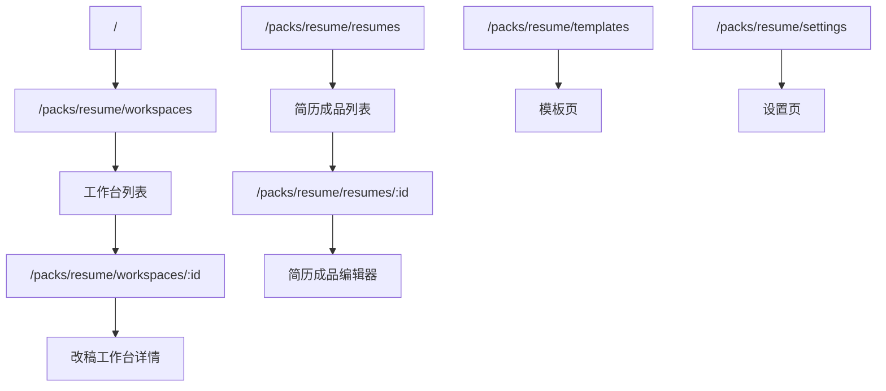
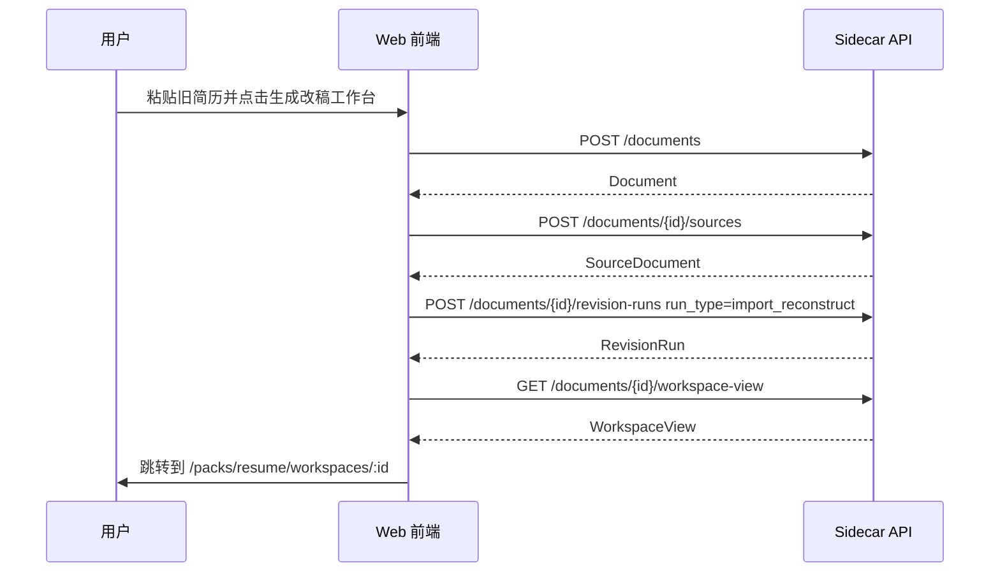

# Resume Pack 工作台入口设计

> 日期：2026-05-26
> 状态：待用户评审
> 范围：前端信息架构、路由、侧边栏、工作台列表、简历成品列表

## 背景

当前导入旧简历后，系统会创建一个改稿工作台，并进入 `workspace-view` 展示 AI 生成的草稿、问题卡和修改建议。但用户如果关闭页面或离开工作台，前端没有一个明确入口可以再次回到这些已创建的工作台。

同时，TypeDance 后续会演进为 Pack 形态。不同 Pack 的对象、菜单和页面不同。简历只是其中一个 Pack，因此不能把当前全局导航继续固化为“TypeDance 首页 + 简历列表”的结构。用户已确认当前产品尚未上线，不需要兼容旧链接，可以直接建立新的 `/packs` 路由体系。

## 目标

- 让用户能从前端重新进入已创建的简历改稿工作台。
- 建立 Pack 感知的信息架构：当前 Pack 决定左侧菜单、页面入口和默认落点。
- 在 Resume Pack 内明确区分“工作台”和“简历成品”两个概念。
- 所有新路由统一放在 `/packs` 前缀下，为后续更多 Pack 留结构空间。
- 移除旧路由和旧导航入口，不做历史链接兼容。

## 非目标

- 不实现多 Pack 切换器的完整交互；当前只有一个 Pack 时不展示切换按钮。
- 不调整后端核心数据模型。
- 不合并“工作台”和“简历成品”概念。
- 不保留旧路由跳转、重定向或兼容层。
- 不在本设计阶段实现代码；本文件用于先确认产品结构。

## 核心原则

1. **Pack 是一级产品上下文**：进入 Resume Pack 后，用户看到的是简历相关菜单，而不是全局通用菜单。
2. **工作台是过程资产**：承载导入重构、AI 检查、问题卡、修改建议和草稿演进。
3. **简历成品是结果资产**：承载可编辑、可导出、可复用的最终简历版本。
4. **不兼容未上线产品的历史链接**：路由和测试可以直接迁移到新结构。

## 信息架构

Resume Pack 下的左侧菜单：

| 菜单 | 含义 | 主要对象 |
| --- | --- | --- |
| 工作台 | AI 改稿、导入重构、质量检查的过程空间 | `Document` / `WorkspaceView` |
| 简历成品 | 用户可继续编辑、导出、复用的简历文件 | `ResumeVersion` |
| 模板 | 简历模板浏览与应用 | `Template` |
| 设置 | 当前 Pack 与模型等设置入口 | settings |

页面关系：



## 路由设计

新路由：

| 路由 | 页面 | 说明 |
| --- | --- | --- |
| `/` | 默认入口 | 进入 Resume Pack 的工作台列表 |
| `/packs/resume/workspaces` | 工作台列表 | 展示所有改稿工作台 |
| `/packs/resume/workspaces/:id` | 工作台详情 | 展示单个 `Document` 的 `WorkspaceView` |
| `/packs/resume/resumes` | 简历成品列表 | 展示已有 `ResumeVersion` |
| `/packs/resume/resumes/:id` | 简历成品编辑器 | 编辑可导出的简历成品 |
| `/packs/resume/templates` | 模板页 | 浏览和应用模板 |
| `/packs/resume/settings` | 设置页 | 模型配置和 Pack 设置 |

需要移除的旧路由：

| 旧路由 | 新位置 |
| --- | --- |
| `/workspace/:id` | `/packs/resume/resumes/:id` |
| `/revision/:documentId` | `/packs/resume/workspaces/:id` |
| `/templates` | `/packs/resume/templates` |
| `/settings` | `/packs/resume/settings` |

因为产品尚未上线，访问旧路由时不需要重定向到新地址；可以直接交给通用 404 或默认路由处理。

## 侧边栏与 Pack Identity

左上角从全局 TypeDance 品牌位调整为当前 Pack 身份：

- 主标题：`简历`
- 副标题：`Resume Pack`
- 图标：使用现有 sidebar 图标按钮容器，图标表达当前 Pack。
- 切换按钮：当前只有一个 Pack 时隐藏；当 `packs.length > 1` 时再显示。

导航菜单由当前 Pack 配置生成，而不是在 Sidebar 中写死全局菜单。第一版可内置：

```ts
const resumePackNavigation = [
  { id: "workspaces", label: "工作台", path: "/packs/resume/workspaces" },
  { id: "resumes", label: "简历成品", path: "/packs/resume/resumes" },
  { id: "templates", label: "模板", path: "/packs/resume/templates" },
  { id: "settings", label: "设置", path: "/packs/resume/settings" },
];
```

后续新增 Pack 时，只需要增加新的 pack config，而不是改造每个页面的导航判断。

## 页面设计

### 工作台列表

位置：`/packs/resume/workspaces`

职责：

- 展示所有可继续进入的改稿工作台。
- 保留“导入旧简历”入口，导入完成后进入新建工作台详情页。
- 可保留“从空白开始”入口，但它创建的是后续可进入的工作台或成品，需要在实现计划中明确具体数据流。

列表项展示建议：

- 工作台名称：优先使用 `Document.title`。
- 状态：根据最近一次 run 或 `workspace-view.run_status` 展示。
- 最近更新时间：来自 `Document.updated_at` 或列表接口可用字段。
- 摘要：可使用 `coach_summary.summary` 或 source summary；列表接口没有摘要时先不展示。

状态：

- 加载中：显示列表骨架或简洁 loading。
- 空状态：提示“导入旧简历或新建简历来开始改稿”。
- 错误：展示“工作台加载失败”，提供重试按钮。

### 工作台详情

位置：`/packs/resume/workspaces/:id`

职责：

- 承载已有改稿工作台页面。
- 通过 `GET /documents/{id}/workspace-view` 拉取聚合视图。
- 页面对象是 `Document`，不是 `ResumeVersion`。

进入方式：

- 导入旧简历成功后跳转。
- 工作台列表点击进入。
- 直接访问新路由进入。

### 简历成品列表

位置：`/packs/resume/resumes`

职责：

- 展示当前已有简历成品。
- 沿用现有 `GET /resume-versions` 数据来源和卡片展示能力。
- 点击成品进入简历编辑器。

此页面不展示导入重构的过程工作台，避免用户把“AI 改稿过程”和“可导出成品”混在一起。

### 简历成品编辑器

位置：`/packs/resume/resumes/:id`

职责：

- 承载当前已有的简历编辑器。
- 页面对象是 `ResumeVersion`。
- 保留已有模板、样式、导出等能力。

### 模板页

位置：`/packs/resume/templates`

职责：

- 保持当前模板库能力。
- 所有跳转路径切到 Pack 前缀下。

### 设置页

位置：`/packs/resume/settings`

职责：

- 保持当前模型设置能力。
- 作为 Resume Pack 内设置入口展示。

## 数据流与 API

导入旧简历流程保持当前后端逻辑：



新增或调整的前端 API helper：

| 前端函数 | 后端接口 | 用途 |
| --- | --- | --- |
| `listRevisionDocuments` | `GET /documents` | 工作台列表 |
| `getRevisionWorkspaceView` | `GET /documents/{id}/workspace-view` | 工作台详情 |
| `listResumeVersions` | `GET /resume-versions` | 简历成品列表 |

实现时如果 `GET /documents` 返回字段不足以支撑列表摘要，第一版先展示可用字段，不为了摘要新增后端复杂度。

## 测试计划

前端测试：

- `/` 默认进入 `/packs/resume/workspaces`。
- Resume Pack 侧边栏展示 `简历 / Resume Pack`。
- 当前只有一个 Pack 时不展示切换按钮。
- 工作台菜单高亮和跳转到 `/packs/resume/workspaces`。
- 简历成品菜单高亮和跳转到 `/packs/resume/resumes`。
- 工作台列表调用 `GET /documents` 并能点击进入详情。
- 导入旧简历成功后跳转到 `/packs/resume/workspaces/:id`。
- 简历成品列表继续调用 `GET /resume-versions`。
- 模板和设置页面使用 Pack 前缀路径。

需要调整或删除旧测试：

- 删除依赖旧路由的断言。
- 删除旧首页等同于简历成品列表的断言。
- 将 revision/workspace 的命名断言改为 workspaces/resumes。

## 验收标准

- 用户关闭工作台后，可以从“工作台”菜单重新进入已创建的改稿工作台。
- “工作台”和“简历成品”在左侧菜单和路由上清晰分离。
- 左上角显示当前 Resume Pack 身份，而不是只显示 TypeDance 全局品牌。
- 所有主要页面都使用 `/packs/resume/...` 路由。
- 旧路由没有兼容逻辑。
- 现有模型设置、模板页、简历编辑器能力在新路由下可继续使用。
