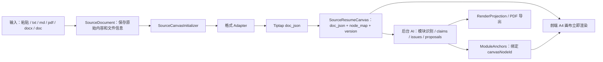

# 工作台初始化与多格式源画布设计

> 范围：旧简历导入、`source_resume_canvas.doc_json` 初始化、现有文件格式支持、工作台首屏加载、后台 AI 识别对接。

## 背景

当前旧简历导入把“可见画布初始化”和“AI 改稿任务生成”放在同一条同步链路中。用户上传或粘贴旧简历后，需要等待 source parser、structurer、claims、issues、proposals、render projection 等步骤完成，才能进入工作台。这让首屏等待时间过长，也让 Markdown 嵌套列表等依赖完整上下文的结构在进入官方 Tiptap Markdown 解析前被按行拆散。

新的目标是把工作台初始化拆成快慢两条路径：

- 快路径：所有现有输入格式先生成 `SourceResumeCanvas.doc_json`，让 A4 原始画布立即出现并可编辑。
- 慢路径：AI 后台识别模块、事实、问题和建议，逐步补充右侧面板与模块锚点。

## 目标

1. 支持现有导入格式：粘贴文本、`.txt`、`.md`、`.markdown`、`.pdf`、`.docx`、`.doc`。
2. 工作台首屏不等待 AI 完整重构，能先展示可编辑 A4 原始画布。
3. Markdown 以完整上下文解析，嵌套有序/无序列表、标题、加粗、代码、分割线等语法进入结构化 `doc_json`。
4. DOCX 尽量保留段落、标题、列表、基础内联样式。
5. PDF 和旧 DOC 至少稳定抽取可编辑文本，结构识别采用 best effort，不阻塞首屏。
6. AI 结果绑定 canvas 版本，避免用户编辑后后台结果错位。
7. `ParsedBlock` 继续服务 AI 和证据链，但不再作为源画布内容的主输入。

## 非目标

1. 不在本阶段实现图片 OCR。
2. 不要求 PDF 完美还原视觉排版、分栏和页面坐标。
3. 不把 AI 用于首屏画布初始化。
4. 不把 `render_projection.doc_json` 当作第一屏原始简历画布。
5. 不保留旧的“逐 block 转源画布”运行时代码；切换到新的唯一初始化路径。

## 核心模型

`source_resume_canvas.doc_json` 是 A4 原始画布的文档本体，用于 Tiptap 渲染、编辑和保存。它不是事实源，也不是 AI 结构化草稿。

`ParsedBlock` 是语义层材料，用于 AI 识别、证据引用、模块锚点和问题卡定位。它可以从原文或 `doc_json` 派生，但不能决定源画布的主结构。

`render_projection.doc_json` 是结构化草稿的投影，用于后续预览、导出或下游结构化视图，不参与首屏原始画布初始化。

## 目标架构



## 快路径

快路径在创建 source 后立即运行，不调用 AI：

```text
创建 Document
-> 创建 SourceDocument
-> SourceCanvasInitializer 读取 source
-> 根据 source 格式生成 doc_json/node_map/version
-> 保存 SourceResumeCanvas
-> 返回 WorkspaceView
-> 前端进入工作台
```

快路径成功后，工作台允许 `current_draft`、`modules`、`issues`、`proposals` 为空。A4 画布是主体验，右侧显示 AI 识别进度。

## 慢路径

慢路径可以由原有 `import_reconstruct` run 触发，但它不再阻塞首屏：

```text
读取 SourceDocument + SourceResumeCanvas(version)
-> 生成或读取 ParsedBlock
-> 调用 ResumeStructurer
-> 保存 DocumentModule / DocumentClaim
-> 生成 Evidence / Issues / Proposals
-> 根据 source refs 映射到 canvasNodeId
-> 更新 WorkspaceView
```

AI 输出必须记录输入的 `source_canvas_id` 和 `source_canvas_version`。如果保存结果时发现画布版本已变更，结果进入 stale 状态或仅作为待重新识别提示，不直接覆盖当前锚点。

## 格式 Adapter

### Markdown

`.md`、`.markdown` 和看起来像 Markdown 的粘贴文本，必须以完整文本交给 Tiptap 官方 Markdown parser。禁止先 `splitlines()`、`strip()` 后逐行解析。

输出要求：

- `#` / `##` 解析为 heading。
- `-`、`*`、`+`、`1.` 解析为列表。
- 嵌套列表保留父子/孙子结构。
- `**bold**`、`_italic_`、inline code 等基础 mark 保留。
- `---` 解析为 horizontalRule。

### 纯文本

`.txt` 和非 Markdown 粘贴文本走确定性文本 adapter：

- 空行分段。
- 常见中文章节标题可转为 heading。
- 行首 `-`、`*`、`•`、`·`、数字编号可合并为列表。
- 不进行润色、重写或语义归类。

### DOCX

DOCX adapter 优先读取 Word 文档结构：

- 段落、标题、列表层级。
- bold、italic、underline 等基础内联样式。
- 表格在第一阶段可降级为段落组或简化表格节点。

如果结构解析失败，才进入明确的文本降级路径，并给 source metadata 记录降级原因。

### PDF

PDF adapter 采用文本和行级版面抽取：

- 按页和阅读顺序生成文本块。
- 根据字号、粗细、行距、项目符号和编号做 best effort 标题/列表识别。
- 不要求还原 PDF 视觉排版。
- 抽取不到有效文本时返回明确错误，不进入空白工作台。

### DOC

旧 `.doc` 继续通过统一文档抽取器处理。能抽到结构时使用结构；只能抽到文本时走纯文本 adapter。抽取失败时返回明确错误，提示用户另存为 `.docx` 或粘贴文本。

## 节点与锚点

初始化器为可定位节点生成稳定属性：

- `canvasNodeId`：画布节点 ID。
- `sourceBlockId`：对应源材料片段 ID。
- `moduleId`：AI 识别完成后再写入或通过 overlay 映射，不作为首屏必需字段。

对于嵌套列表，`canvasNodeId` 应挂在对应 `listItem` 或其主段落节点上，保证模块锚点和问题卡能跳到正确位置。

`node_map` 从最终 `doc_json` 派生，记录每个可定位节点的文本、节点类型、source span 和当前 module 绑定。

## API 与状态

导入接口应返回可立即打开的工作台视图。推荐状态：

```text
source.parse_status:
  pending -> initialized -> recognizing -> recognized
  pending -> initialized -> recognition_failed
```

`WorkspaceView` 支持：

- `source_resume_canvas` 已存在。
- `current_draft` 为空或待生成。
- `modules/issues/proposals` 为空。
- `import_progress` 或等价字段展示后台阶段。

前端打开工作台后轮询或订阅 workspace view 更新，直到 AI 慢路径完成。

## 前端交互

首屏展示：

- 中间：A4 原始简历画布，立即可编辑。
- 顶部：保存状态与后台识别阶段。
- 右侧：识别中状态、空模块列表、空问题建议列表。

画布不能被全屏 spinner 阻塞。后台失败时，画布继续可用，右侧提供重试识别入口。

画布内粘贴 Markdown 时，前端使用 Tiptap Markdown parse 插入结构化节点，而不是插入纯文本源码。

## 错误处理

- 文件为空：导入接口返回“文件没有可读取内容”。
- 不支持格式：返回明确扩展名错误。
- PDF/DOC 抽取失败：返回格式化错误，并建议粘贴文本或转换为 DOCX。
- AI 识别失败：不影响画布，右侧显示失败和重试。
- AI 结果过期：提示当前画布已编辑，需要重新识别。

## 验收标准

1. 导入 `.md` 后，嵌套有序/无序列表在 A4 画布中显示为真实嵌套列表，而不是 Markdown 源码。
2. 粘贴 Markdown 到画布后，列表、标题、加粗和分割线转为富文本结构。
3. `.txt` 和普通粘贴文本能生成可编辑 A4 画布。
4. `.docx` 至少保留段落、标题、列表和基础内联样式。
5. `.pdf` 至少稳定抽取文本并生成可编辑 A4 画布。
6. `.doc` 能抽取文本则进入工作台；抽取失败时给明确错误。
7. 导入后工作台首屏不等待 AI 完整完成。
8. AI 识别中，右侧面板显示阶段状态，画布可编辑并可自动保存。
9. AI 结果只应用到匹配的 source canvas version。
10. `render_projection` 不参与首屏原始画布渲染。

## 测试计划

- `@typedance/resume-markdown`：覆盖完整 Markdown 嵌套列表、标题、inline marks、horizontalRule。
- sidecar adapter：覆盖 txt、md、docx、pdf、doc 的初始化输出。
- source canvas：验证 `doc_json`、`node_map`、`canvasNodeId`、嵌套 list item 锚点。
- import flow：验证 source canvas 先于 AI 结果可用。
- workspace view：验证 `current_draft` 为空但 `source_resume_canvas` 存在时前端可渲染。
- 前端：验证导入后跳转工作台、识别中状态、Markdown 粘贴结构化。
- 回归：验证 PDF 导出仍走 `render_projection`，不带模块 hover/outline 状态。

## 迁移顺序

1. 建立 `SourceCanvasInitializer` 和格式 adapter 接口。
2. 扩展 JS Markdown 转换器支持完整文档转换和节点 ID 注入。
3. 将 `SourceResumeCanvasBuilder` 从逐 block 输入改为 source 输入。
4. 调整 import flow：先保存 source canvas，再启动 AI 慢路径。
5. 调整 WorkspaceView 与前端空状态。
6. 增加 version 绑定和 stale AI 结果处理。
7. 删除运行时代码中的旧逐 block 画布路径。
