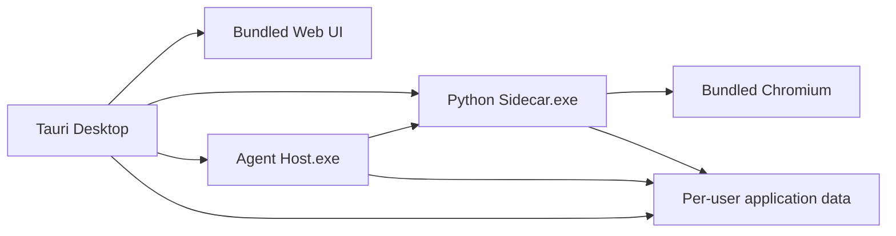

# TypeDance Windows Release 安装包设计

**日期：** 2026-06-19

**状态：** 已确认

**目标平台：** Windows x64

**安装包格式：** NSIS `.exe`
**首版签名策略：** 不签名

## 1. 目标

为 TypeDance 增加一条可重复执行的 Windows Release 构建链路。开发者在仓库根目录执行：

```powershell
pnpm release
```

即可得到可交付给普通 Windows 用户安装的 NSIS 安装包及其 SHA-256 校验文件。安装后的应用必须独立运行，不要求用户预装 Node.js、Python、pnpm、Rust 或 Chromium。

同时提供：

```powershell
pnpm release:publish
```

用于在本机已登录 GitHub CLI 的前提下，将当前版本安装包发布到对应 GitHub Release。GitHub Actions 复用同一条底层构建脚本，避免本机与 CI 出现两套发布逻辑。

## 2. 范围

本次包含：

- Windows x64 NSIS 安装包构建；
- Web UI、Python Sidecar、Agent Host 与 Chromium 的完整随包分发；
- Tauri 对后台进程的启动、健康检查和退出清理；
- Release 版模型配置与开发 `.env` 的隔离；
- 根目录 `pnpm release` 与 `pnpm release:publish` 命令；
- GitHub Release 自动发布工作流；
- 安装包冒烟测试和敏感文件审计；
- Release 构建文档。

本次不包含：

- macOS、Linux 或 Windows ARM64 安装包；
- MSI 安装包；
- Windows 代码签名；
- 自动更新；
- 云端 Agent Host 或 Sidecar；
- 安装时删除或迁移现有用户数据。

## 3. 架构边界

Release 打包不改变现有职责边界：

- **Tauri Desktop** 负责应用安装、OS 集成、应用数据目录解析、单实例、Sidecar 生命周期和启动失败提示。Tauri 不实现简历业务逻辑或 AI 编排。
- **Python Sidecar** 保持业务数据、本机资源、画布、导入、导出和 PDF 渲染职责。它被打包为独立 Windows 可执行文件。
- **TS Agent Host** 保持模型设置、Conversation、Message、Run、插件绑定、上下文引用和模型调用职责。它被打包为独立 Windows 可执行文件。
- **Harness Core** 不感知 TypeDance、桌面安装、Python 或简历业务，保持通用 Agent Runtime。
- **Web Frontend** 继续分别调用 Python Sidecar 和 Agent Host，不承载后台进程编排。



## 4. 发布单元

### 4.1 Web UI

Web UI 使用现有 Vite 生产构建，输出到 `apps/web/dist`，由 Tauri 作为 `frontendDist` 打进应用。生产构建不注入模型 API Key，也不复制 `.env`。

### 4.2 Python Sidecar

Python Sidecar 使用 PyInstaller 生成 Windows x64 可执行文件。实现顺序为先验证 one-folder 模式，再切换到最终 one-file 产物，以便先排除缺失模块和动态资源问题。

Sidecar 构建必须包含 FastAPI、Uvicorn、MCP、Playwright 及项目自身 Python 包，但 Chromium 不嵌入 PyInstaller 单文件；Chromium 作为 Tauri resource 单独随包分发，Sidecar 启动时通过明确的资源路径使用它。

Sidecar 可执行文件必须提供健康检查能力，Tauri 据此确认服务已经可用。

### 4.3 Agent Host

Agent Host 先将当前 TypeScript 与 workspace 依赖打成单一 CommonJS JavaScript 入口，再使用 Node.js 24 Single Executable Applications 生成 Windows x64 可执行文件。Resume 插件所需的静态 skill 内容必须作为明确资源打入可执行文件或 Tauri resources，不能依赖仓库源码目录。

Agent Host 启动时不再向当前目录的父级自动搜索 `.env`。开发环境需要环境变量时，由开发命令显式传入；Release 运行时从用户数据目录读取模型设置。

### 4.4 Chromium

构建脚本下载与 Python Playwright 版本匹配的固定 Chromium 版本，并将浏览器目录作为 Tauri resource 打包。运行时禁止再次联网下载浏览器，以保证安装后 PDF 导出可离线初始化。

### 4.5 Tauri NSIS 安装包

Tauri `bundle.targets` 仅启用 NSIS，不再使用 `all`。`externalBin` 注册 Python Sidecar 和 Agent Host，`resources` 注册 Chromium 与必须的静态资源。安装包命名统一为：

```text
TypeDance_<version>_x64-setup.exe
TypeDance_<version>_x64-setup.exe.sha256
```

首版不签名，因此 Windows SmartScreen 可能显示“未知发布者”。发布说明必须明确这一点。

## 5. 运行时生命周期

Tauri 启动顺序固定为：

1. 获取 Tauri per-user application data 目录；
2. 确保 TypeDance 单实例运行；
3. 启动 Python Sidecar，并显式传入数据目录和 Chromium 路径；
4. 在有限超时内轮询 Sidecar 健康检查；
5. 启动 Agent Host，并显式传入数据目录与 Sidecar 地址；
6. 在有限超时内轮询 Agent Host 健康检查；
7. 两个服务均就绪后显示主窗口。

任一进程启动失败、提前退出或健康检查超时，Tauri 都显示包含失败服务和可操作建议的错误信息，并停止已经启动的其他子进程。应用关闭时，Tauri 终止并等待两个子进程退出，不遗留后台孤儿进程。

首版沿用现有 loopback 服务端口 `4317` 和 `4327`。单实例防止 TypeDance 自身重复占用端口；如果端口被其他程序占用，启动流程明确报错，不静默切换端口。

## 6. 模型设置与敏感信息边界

Release 安装包不得包含构建机器的模型凭据。规则如下：

- `.env`、`.env.*`、证书、私钥、开发数据库和本机认证文件均不属于构建输入；
- Vite 生产构建不得接收模型 API Key；
- Agent Host 不自动发现 `.env`；
- 缺少 API Key 时 Agent Host 仍能启动，应用非 AI 功能保持可用；
- 用户在应用“模型设置”中输入自己的 API Key；
- Agent Host 负责模型设置 API 与密钥语义，设置响应只返回是否已配置及脱敏预览；
- API Key 保存在 per-user application data 目录中的专用认证文件，文件不进入安装目录、Git 仓库、构建缓存或 Release 产物；
- 日志、错误信息、健康检查和 GitHub Actions 输出不得打印 API Key。

本次不把开发 `.env` 作为 Release 的 fallback。开发环境若需要 `.env`，由开发脚本显式指定文件，Release 脚本不读取该文件。

## 7. 构建命令设计

根目录 `package.json` 增加：

```json
{
  "scripts": {
    "release": "powershell -NoProfile -ExecutionPolicy Bypass -File scripts/release-windows.ps1",
    "release:publish": "powershell -NoProfile -ExecutionPolicy Bypass -File scripts/release-windows.ps1 -Publish"
  }
}
```

`scripts/release-windows.ps1` 是本机和 GitHub Actions 的唯一发布入口，职责为：

1. 检查当前系统为 Windows x64；
2. 检查 Node.js、pnpm、Python、Rust、Cargo 和 Git；
3. 校验 Git 工作区状态与版本号；
4. 运行相关测试与生产构建；
5. 构建 Agent Host 单文件；
6. 构建 Python Sidecar 单文件；
7. 准备固定版本 Chromium；
8. 调用 Tauri 生成 NSIS 安装包；
9. 将最终产物复制到 `artifacts/release/windows-x64/`；
10. 生成 SHA-256 文件；
11. 执行产物内容和安装冒烟检查；
12. 在 `-Publish` 模式下使用本机已认证的 `gh` 发布对应版本。

脚本默认 fail-fast。任何子步骤失败都返回非零退出码，并删除本次尚未通过验收的最终产物，避免残缺安装包被误认为成功 Release。

## 8. 版本与发布规则

根 `package.json`、`apps/desktop/package.json`、`tauri.conf.json` 与 `Cargo.toml` 的版本号必须一致。`pnpm release` 只负责验证，不在构建过程中隐式修改源码版本。

GitHub Release 使用 `v<version>` 标签，例如 `v0.1.0`。`pnpm release:publish` 校验：

- 当前分支工作区干净；
- 当前提交存在对应标签或能够安全创建该标签；
- GitHub CLI 已认证；
- Release 中不存在同名但校验值不同的安装包。

发布操作不读取或保存 GitHub Token；认证完全交给本机 GitHub CLI。GitHub Actions 使用仓库自动提供的最小权限 `GITHUB_TOKEN`。

## 9. GitHub Actions

新增 Windows Release workflow：

- 仅在 `v*` 标签触发；
- 使用 Windows x64 runner；
- 安装固定版本 Node.js、pnpm、Python 和 Rust；
- 不配置任何模型 API Key 或项目 `.env`；
- 调用与本机相同的 `scripts/release-windows.ps1`；
- 上传 NSIS 安装包和 SHA-256 文件到 GitHub Release；
- workflow 权限仅包含读取仓库内容和写入 Release 所需权限。

## 10. 验证策略

### 10.1 构建前验证

- contracts、Harness Core、Agent Host、Web 和 Sidecar 的相关测试通过；
- Web、Agent Host 与 Rust 生产构建通过；
- Sidecar 与 Agent Host 独立可执行文件能启动并通过健康检查；
- Chromium 路径解析测试通过；
- 四处版本号一致；
- Tauri external binaries 与 resources 均存在且非空。

### 10.2 安装包验证

- NSIS 安装包可静默安装到临时路径；
- 已安装 TypeDance 可启动；
- Python Sidecar 与 Agent Host 均健康；
- 未配置 API Key 时主界面与非 AI 功能可用；
- PDF 导出能使用随包 Chromium 完成；
- 开始菜单入口和卸载器存在；
- 静默卸载成功；
- 卸载只删除程序文件，用户数据仍保留。

### 10.3 敏感信息审计

构建脚本以路径和文件名白名单控制打包内容，并对中间目录、安装目录和最终产物执行审计。以下内容一旦出现即构建失败：

- `.env` 或 `.env.*`；
- `.pem`、`.pfx`、`.p12`、`.key`；
- 本机认证文件；
- 开发数据库；
- 仓库 `.git` 元数据；
- 非预期源码目录。

审计只报告违规文件路径或类别，不输出文件内容。

## 11. 错误处理

- 缺少构建依赖：输出缺少的工具及安装建议后退出；
- 版本不一致：列出文件与版本后退出；
- Sidecar 或 Agent Host 打包失败：不调用 Tauri bundle；
- Chromium 下载或版本验证失败：不生成安装包；
- NSIS 构建失败：不复制任何最终产物；
- 安装冒烟失败：删除本次最终产物并保留诊断日志；
- 敏感信息审计失败：只输出命中的路径类别并退出；
- GitHub 发布失败：保留本地已验证产物，不回滚本地构建。

## 12. 验收标准

本设计完成后的可见结果为：

1. 开发者在仓库根目录执行 `pnpm release`，一次命令得到 Windows x64 NSIS 安装包和 SHA-256 文件；
2. 在未安装 Node.js、Python、pnpm、Rust 或 Playwright 的干净 Windows 用户环境中，安装后的 TypeDance 能启动并完成非 AI 功能及 PDF 导出；
3. 用户配置自己的 API Key 后，AI 对话可用；
4. 构建机器的 `.env` 和任何凭据均未进入 Web、可执行文件、安装目录或 GitHub Release；
5. `pnpm release:publish` 可以复用同一构建链路发布 GitHub Release；
6. GitHub 标签发布与本机构建得到同一结构的产物；
7. 安装、启动、退出、卸载和用户数据保留行为均通过验收。

## 13. 参考文档

- [Tauri 2 Windows Installer](https://v2.tauri.app/distribute/windows-installer/)
- [Tauri 2 Sidecar](https://v2.tauri.app/develop/sidecar/)
- [Node.js 24 Single Executable Applications](https://nodejs.org/docs/latest-v24.x/api/single-executable-applications.html)
- [PyInstaller Stable Documentation](https://pyinstaller.org/en/stable/)
